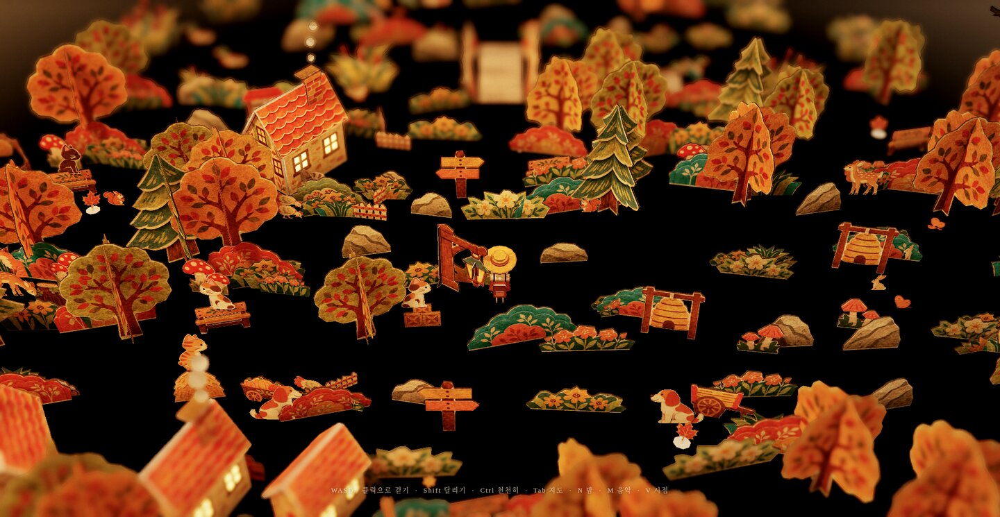
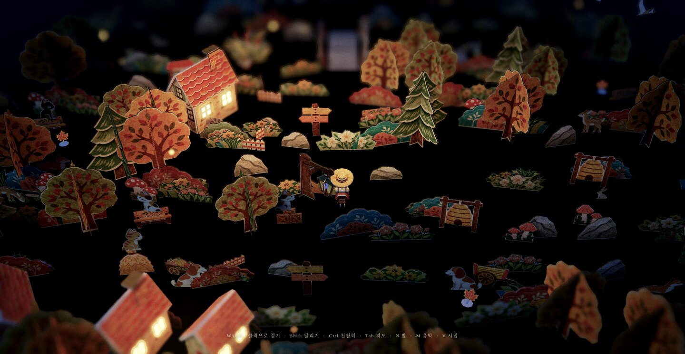
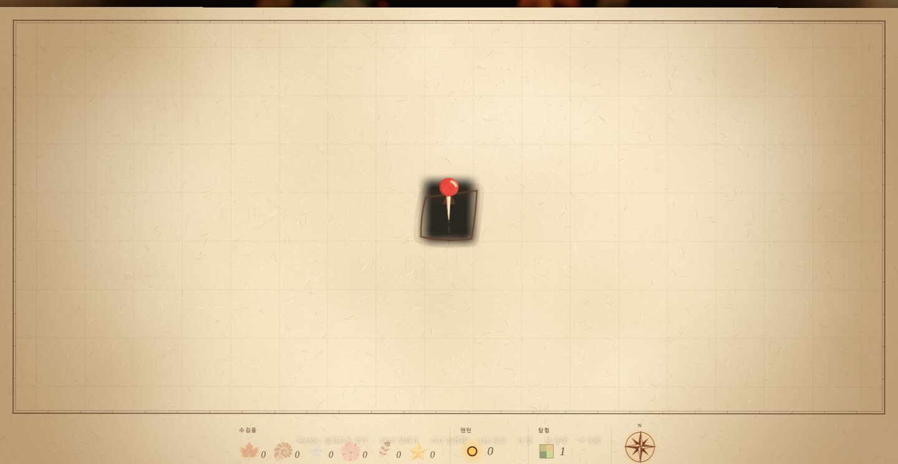

# 페이퍼트레일 (Papertrails) 한국어판

끝없이 이어지는 팝업북 속 종이 세계를 걸어 다니는 3D 산책 게임 [Papertrails](https://github.com/xikhar/papertrails)의 한국어판입니다. 손으로 오려 만든 듯한 마을, 숲, 강, 길 위를 작은 여행자가 랜턴을 들고 걷습니다. 원작은 xikhar(Shikhar)가 만들었고 MIT 라이선스로 공개되어 있습니다.

**바로 플레이: https://sigco3111.github.io/papertrails-ko/**

| 링크 | 주소 |
| --- | --- |
| 한국어판 플레이 | https://sigco3111.github.io/papertrails-ko/ |
| 원본 저장소 | https://github.com/xikhar/papertrails |
| 원본 플레이 | https://xikhar.github.io/papertrails/ |
| 원본 README | [README.en.md](README.en.md) |



> 위 화면은 한국어판 배포본을 클라우드 브라우저(가상 GPU)에서 직접 실행해 캡처한 것입니다. 이 환경에서는 바닥 종이 질감이 보이지 않고 배경이 검게 나옵니다. 원인은 확인하지 못했습니다. 실제 바닥 모습은 아래 원작 이미지를 참고하세요. 하단 조작 안내 문구가 한국어로 표시됩니다.



> `?night=1` 로 연 밤 화면입니다. 창문 불빛이 켜지고 전체가 어두워집니다. 바닥은 같은 환경 한계로 검게 보입니다.



> Tab 으로 연 지도 화면입니다. 하단에 한국어 라벨(수집품, 랜턴, 탐험)이 표시됩니다. 탐험한 칸의 바닥은 이 환경에서 어둡게 나옵니다.

## 소개

- 화면에 글자가 거의 없는 게임입니다. 하단에 잠깐 나타났다 사라지는 조작 안내가 유일한 문구입니다.
- 걷는 길마다 월드가 새로 펼쳐지는 무한 지도입니다. 같은 시드이면 같은 세계가 만들어집니다.
- 한국어판은 게임 로직을 건드리지 않고, 화면에 보이는 문구와 배포 설정만 바꿨습니다.

## 주요 기능

- **끝없는 종이 세계:** 마을, 숲, 사막, 눈 덮인 마을, 벚꽃 숲, 소나무 숲 등 지형이 이어지고, 강과 길이 끊기지 않게 연결됩니다.
- **팝업 접힘 효과:** 종이 조각이 접혀 있다가 여행자가 다가가면 용수철처럼 일어나 살짝 흔들립니다.
- **랜턴 점등:** 등불은 처음에 꺼져 있고, 랜턴을 든 여행자가 가까이 가면 켜진 채로 남습니다.
- **종이 수집품:** 지형마다 수집품이 놓여 있습니다. 눌린 나뭇잎, 화석 조개, 종이 눈송이, 눌린 꽃잎, 올빼미 깃털, 그리고 밤에만 나타나는 종이 별입니다.
- **낮과 밤:** 밤이 되면 창문과 등불이 빛납니다.
- **지도:** 탐험한 구역, 수집품, 켠 랜턴을 지도에서 볼 수 있습니다.
- **분위기:** 날리는 낙엽, 눈, 꽃잎, 나비, 새, 연기 같은 작은 종이 조각과 잔잔한 피아노 배경 음악이 있습니다.
- **진행 저장:** 탐험, 수집, 점등 기록이 브라우저(localStorage)에 시드별로 저장됩니다.

## 조작법

| 키 | 기능 |
| --- | --- |
| WASD / 클릭 | 걷기 |
| Shift | 달리기 |
| Ctrl | 천천히 걷기 |
| Tab | 지도 |
| N | 밤/낮 전환 |
| M | 음악 켜기/끄기 |
| V | 시점 전환 (여정, 가까이, 넓게, 낮게, 엽서) |

주소 뒤에 `?seed=숫자`, `?quality=low|med|high`, `?mute=1`, `?hint=0`, `?night=1` 같은 옵션을 붙일 수 있습니다. 코드(`src/main.js`)에 적힌 옵션입니다.

## 원작 이미지

아래 세 장은 원본 저장소가 제공한 이미지입니다.


## 실행 방법

Node.js 22 이상과 npm이 필요합니다.

```bash
git clone https://github.com/sigco3111/papertrails-ko.git
cd papertrails-ko
npm ci
npm run dev       # http://127.0.0.1:5273
npm run build     # dist/ 에 정적 파일 생성
npm run preview   # http://127.0.0.1:4273
```

`main` 브랜치에 푸시하면 GitHub Actions(`.github/workflows/pages.yml`)가 빌드 후 GitHub Pages로 배포합니다.

## 기술 설명

- **언어와 도구:** JavaScript(ES 모듈), [Three.js](https://threejs.org/) 0.187, [Vite](https://vite.dev/) 8. 빌드 대상은 ES2022입니다.
- **월드 생성:** 무한 격자를 8x8 청크로 나누고, 청크는 시드와 좌표만으로 만들어집니다. Wave Function Collapse로 타일을 배치하고, 강과 길은 청크 경계 규칙으로 끊기지 않게 이어 붙입니다(`src/world/wfc.js`).
- **책 형태의 렌더링:** 월드는 탁자 위에 놓인 펼친 책 한 권으로 그려지고, 여행자를 따라 움직입니다. 페이지는 타일 모델을 위에서 구운 텍스처 배열로 그립니다(`src/world/book.js`). 접힘은 용수철 모델로 계산합니다(`src/world/fold.js`).
- **후처리:** HDR 렌더 타깃 위에 AO, 보케 심도, 블룸, 비네트, 필름 톤맵, 그레인을 적용합니다. 틸트 시프트 느낌의 초점 연출도 포함됩니다(`src/render/post.js`).
- **생명과 날씨:** 낙엽, 눈, 꽃잎, 나비 같은 조각은 인스턴싱 메시 두 개로 그리며, 위치는 시간 함수로 계산합니다(`src/life/life.js`).
- **음악:** 피아노 음색을 JS로 직접 합성해 연주합니다(`src/audio/music.js`).
- **에셋:** `public/models`의 glTF 모델 2개와 `public/textures`의 종이 질감, 일러스트 아틀라스를 사용합니다.
- **한국어화 방식:** `index.html`의 제목, 설명, 조작 안내, `src/game/catalog.js`의 수집품 이름은 직접 번역했습니다. 지도 라벨(수집품, 랜턴, 탐험)은 원본 파일을 고치지 않고 `vite.config.js`의 빌드 플러그인(`ko-labels`)이 `src/game/atlasmap.js`의 문자열을 빌드 시점에 치환합니다. 배포 경로는 `base: '/papertrails-ko/'`입니다.

### 폴더 구조

```
index.html          진입 페이지 (한국어 메타, 조작 안내)
vite.config.js      빌드 설정, 지도 라벨 치환 플러그인
src/main.js         구성 루트
src/world/          WFC, 책 형태 월드, 접힘, 타일
src/render/         렌더러, 후처리, 낮밤, 조명, 재질
src/game/           수집품, 랜턴, 지도, 진행 저장
src/life/           동물, 날씨, 떠다니는 조각
src/player/         여행자, 입력
src/camera/         추적 카메라, 시점
src/audio/          음악, 효과음
public/             모델, 텍스처, 소셜 카드
```

## 검증 범위

2026-11-19에 클라우드 브라우저(NVIDIA 가상 GPU, Chrome)에서 배포 주소를 열어 확인했습니다.

확인한 것
- 배포 주소 로드, 하단 한국어 조작 안내 표시, 클릭 시 여행자 이동
- `?night=1` 밤 화면 표시, N 키 입력 후 밤에서 낮 방향으로 화면이 바뀌기 시작하는 것
- Tab 지도 화면 열림과 한국어 라벨(수집품, 랜턴, 탐험)
- 정적 에셋(모델, 텍스처) 전부 200 응답, GitHub Pages 배포 성공

확인하지 못한 것과 한계
- 이 환경에서는 로드 직후 WebGL 컨텍스트 손실과 복구 로그가 남고, 바닥 종이 질감이 검게 보입니다. 지도의 탐험한 칸도 어둡게 나옵니다. 원인은 확인하지 못했습니다.
- 같은 환경에서 원본 사이트를 열었을 때도 컨텍스트 손실 로그가 남았고, 확인한 시간(약 1분) 안에는 게임 화면이 나오지 않았습니다. 원본과 한국어판의 차이는 판단하지 못했습니다.
- 바닥이 정상으로 보이는 환경에서의 전체 화면, 달리기·천천히 걷기·시점 전환(V)·음악(M)의 동작, 수집품과 랜턴 상호작용은 확인하지 못했습니다.

## 라이선스와 크레딧

- 라이선스: MIT ([LICENSE](LICENSE))
- 원작: xikhar (Shikhar), https://github.com/xikhar/papertrails
- 에셋과 코드의 저작권은 원작자에게 있으며, 크레딧은 원본 저장소를 따릅니다.
- 한국어판: 화면 문구 번역, 지도 라벨 치환, 배포 설정
